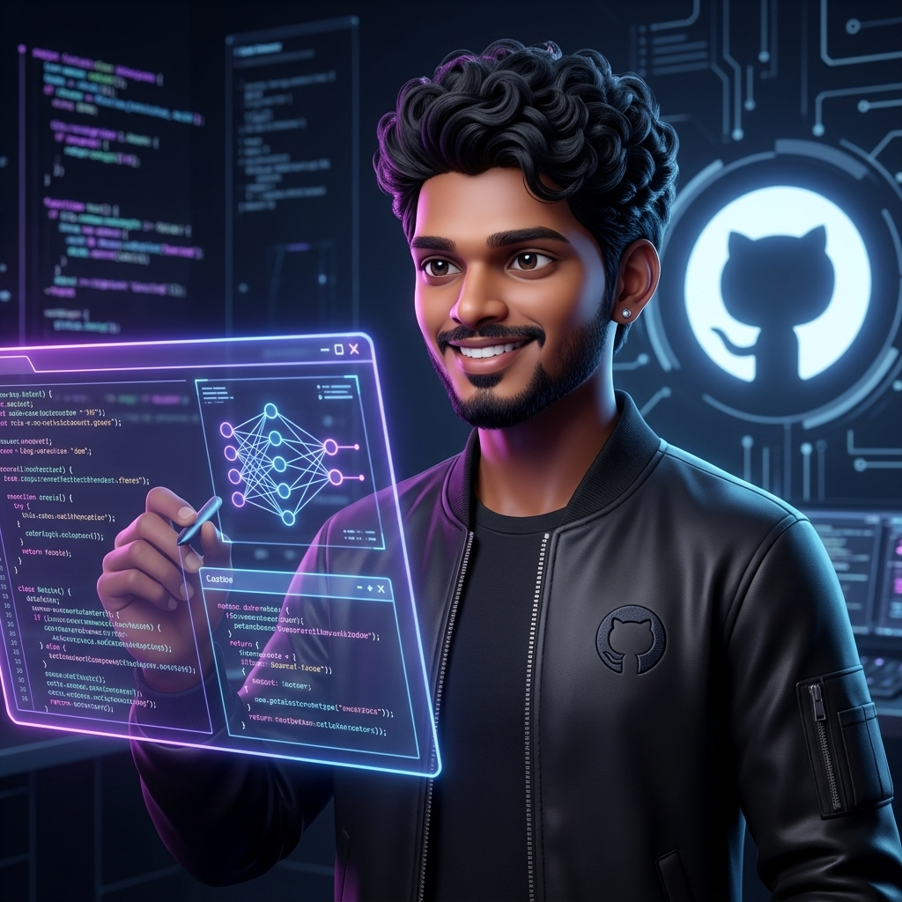

  <!-- Custom Premium Animated Banner -->
  
  
    
  
  <!-- Profile Avatar (AI Generated or Original) -->
  
  
    
  
  <!-- Dynamic Badges -->
  
  
  

---

## 💫 About Me

I am an **AI/ML Engineer** at **Xplore Intellects Pvt Ltd** and Full-Stack Software Developer dedicated to building production-ready automated workflows, Generative AI applications, and robust search engines. I enjoy converting complex requirements into elegant, high-performance code.

- 🧠 **Focus Areas:** Generative AI (LLMs & RAG), Autonomous AI Agents, Computer Vision, and MLOps.
- 🛠️ **Current Pursuits:** Advancing search engine intelligence and intelligent agent workflows.
- ⚡ **Fun Fact:** I love scraping unstructured data from the web and transforming it into useful knowledge graphs!

---

## 🛠️ Tech Stack & Skills

| Area | Technologies |
| :--- | :--- |
| **Languages** |      |
| **Frameworks & Web** |     |
| **AI/ML & Vision** |     |
| **Tools & Cloud** |     |

---

## 🚀 Flagship Projects

### 🔍 [DeepDig](https://github.com/arunak451/deep_search)
An AI-powered Deep Research Search Engine built in Python. It aggregates, compiles, scrapes, and parses business data from 6 channels (Google, Google Maps, LinkedIn, YouTube, News API, and custom BeautifulSoup web scraping). Using Groq's Llama 3.1 8B, it structures raw findings into premium market research reports, with exports to PDF, Excel, and TXT.
* **Tech Stack:** Python, Django/Flask, BeautifulSoup, SerpApi, RapidAPI, Groq API, ReportLab, OpenPyXL.

### 📬 [Daily Job Digest (automatejobsearch)](https://github.com/arunak451/automatejobsearch)
An automated daily job discovery pipeline that reads job alerts from Gmail (LinkedIn, Naukri, Indeed), integrates Google Jobs, scores matches using Groq LLM, selects from 4 tailored resumes, and auto-drafts custom cover letters delivered to inbox every morning at 9:00 AM IST.
* **Tech Stack:** Python, Gmail IMAP, Groq LLaMA 3.1, SerpApi, Report Generation.

### 🎙️ [AI Voice Agent](https://github.com/arunak451/ai-voice-agent)
An end-to-end autonomous AI voice agent combining speech-to-text (STT), LLM-based dialogue management, and realistic text-to-speech (TTS) for automated calling and real-time customer support.
* **Tech Stack:** Python, Speech-to-Text, LLM, TTS, API Webhooks.

### 👁️ [Real-Time Emotion Detector](https://github.com/arunak451/realtime-emotion-detector)
A real-time computer vision system that classifies facial expressions and emotional states directly from live webcam feeds at 30+ FPS.
* **Tech Stack:** Python, OpenCV, Deep Learning, PyTorch, CNNs.

---

## 📊 GitHub Analytics & Consistency

  <table border="0">
    <tr>
      <td align="center" width="50%">
        <!-- Custom Color Theme Stats Card -->
        
      </td>
      <td align="center" width="50%">
        <!-- Custom Color Theme Language Breakdown -->
        
      </td>
    </tr>
    <tr>
      <td align="center" colspan="2">
         
        <!-- Custom Color Theme Streak Card -->
        
      </td>
    </tr>
  </table>

---

## 🤝 Let's Connect!

- **Email:** [aruarun142004@gmail.com](mailto:aruarun142004@gmail.com)
- **LinkedIn:** [arun-kumar-5516572a5](https://linkedin.com/in/arun-kumar-5516572a5)
- **GitHub:** [github.com/arunak451](https://github.com/arunak451)
